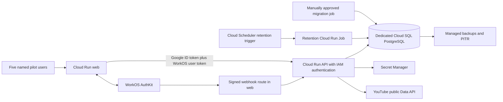

# LabelOS A&R YouTube MVP — Prompt 6: Shared Pilot Deployment Plan

Review date: October 27, 2026, America/Los_Angeles. **Planning only; execution is not approved.**

Recommend a 14-day pilot for at most five named users in two isolated workspaces: Next.js and FastAPI on Cloud Run, a dedicated small Cloud SQL PostgreSQL instance, Secret Manager, and a narrowly scoped retention job. Keep WorkOS authentication and the existing application authorization model. Expected monthly operating cost is **$35–85 USD**, with a proposed **$100 monthly spending authorization** and **$20 one-time restore-test allowance**, subject to the gates below. These are proposed budgets, not configured limits.

The implementation has useful local regression evidence, but it is **not ready to deploy unchanged**. Private API authentication, invite-only admission, container packaging, database privilege verification, reliable retention, backup lifecycle, and the real browser workflow remain release blockers. This plan approves none of those changes or any cloud operation. No infrastructure, billing, cloud secrets, provider configuration, production data, or deployment was changed during this review.

## 1. Repository audit and evidence

Audited the current working tree based on commit `a15bca551e8561a897a71cdd6cb5d77c8c1ffa3d`, including its existing modified and untracked MVP files. That commit alone does not contain the reviewed MVP. A reviewed commit and immutable image digests must replace this working-tree baseline before execution. Existing work was preserved.

| Area            | Repository evidence                                                                                                                                                                                                     | Readiness conclusion                                                                                                                                                                                                                                                                                                                               |
| --------------- | ----------------------------------------------------------------------------------------------------------------------------------------------------------------------------------------------------------------------- | -------------------------------------------------------------------------------------------------------------------------------------------------------------------------------------------------------------------------------------------------------------------------------------------------------------------------------------------------- |
| Stack           | [README](../../README.md), [web Dockerfile](../../apps/web/Dockerfile), [API Dockerfile](../../apps/api/Dockerfile), database SQLAlchemy/Alembic package                                                                | Node 22, pnpm 10.13.1, Python 3.12, PostgreSQL; no Redis, queue, object storage for media, or AI service is required for scouting. `infrastructure/` contains only `.gitkeep`; existing deployed GCP topology is not established by this checkout.                                                                                                 |
| Research        | [routes](../../apps/api/src/labelos_api/api/v1/youtube_research.py), [service](../../apps/api/src/labelos_api/services/youtube_research_service.py)                                                                     | WorkOS bearer authentication; workspace scouting authorization before credential access; running YouTube collection; production-like environments require production collection and currently eligible documentation. Queries and counters are display-only.                                                                                       |
| Shortlist       | [scouting routes](../../apps/api/src/labelos_api/api/v1/scouting.py), [service](../../apps/api/src/labelos_api/services/scouting_service.py), [models](../../packages/database/src/labelos_database/research_models.py) | Human label, notes, status and revision persist separately from expiring channel IDs. Workspace filters, optimistic edit conflicts and concurrent deduplication exist. Deduplication deliberately ends when the source reference expires or is deleted.                                                                                            |
| Quota and cache | [quota ledger](../../apps/api/src/labelos_api/research/youtube_quota.py), [cache](../../apps/api/src/labelos_api/research/youtube_cache.py)                                                                             | Shared SQL budgets of 80 searches and 8,000 channel calls daily across workspaces and replicas using the same database; short process-local caches. Budgets are code constants, not deployment environment settings.                                                                                                                               |
| Lifecycle       | [retention loop](../../apps/api/src/labelos_api/services/scouting_retention.py), [API contract](youtube-research-api.md)                                                                                                | Source reference TTL is currently 29 days. Reads hide expired references; background task purges every minute while running. A scale-to-zero service cannot guarantee that task runs while idle.                                                                                                                                                   |
| Migration       | [quota revision](../../packages/database/alembic/versions/202610270100_youtube_quota.py), [shortlist revision](../../packages/database/alembic/versions/202610270200_scouting.py)                                       | Head is `202610270200`, after `202610270100` and `202610130100`. Quota upgrade needs `-x youtube_quota_approved=true`. Both new downgrades intentionally refuse.                                                                                                                                                                                   |
| Containers      | Dockerfiles above; [database packaging](../../packages/database/pyproject.toml)                                                                                                                                         | Non-root runtime users exist. Web final stage does not copy `apps/web/public`, including YouTube attribution asset. API final stage copies the virtualenv, not Alembic configuration/revisions; database wheel packages only `src/labelos_database`. A separate migration image/target is needed. Actual Linux container builds remain unverified. |
| Private API     | [API client](../../apps/web/src/lib/api-client.ts), [realtime proxy](../../apps/web/src/app/api/realtime/organizations/[organizationId]/events/route.ts)                                                                | Forward WorkOS tokens only; no Cloud Run service identity token. WorkOS webhook receiver currently lives in FastAPI. Private API deployment needs the forwarding changes in section 2.                                                                                                                                                             |
| Operations      | [logging](../../apps/api/src/labelos_api/logging.py), [health](../../apps/api/src/labelos_api/routes/health.py), [realtime](../../apps/api/src/labelos_api/api/v1/realtime.py)                                          | JSON/request correlation and health endpoints exist. `/health/database` returns a JSON error with HTTP 200 when unavailable; a status-only check will miss failure. SSE polls SQL every two seconds and keeps requests active.                                                                                                                     |
| CI              | [workflow](../../.github/workflows/ci.yml), [fixtures](../../apps/api/tests/conftest.py)                                                                                                                                | CI supplies `TEST_POSTGRES_URL`, but fixtures now overwrite it unless a verified disposable runner sets an in-process marker. The existing plain `pytest` CI command does not certify PostgreSQL coverage.                                                                                                                                         |

The [Prompt 5 validation report](youtube-mvp-validation.md) is the current baseline. The [Prompt 4 review](youtube-reliability-policy.md) contains explicitly historical statements about the missing shortlist and unrun local migrations; they must not be treated as current blockers.

Evidence inspected and refreshed:

- Existing `test-results/prompt5-api.xml`: 752 tests, zero failures/errors, 55 skipped, hence **697 passed**. Existing `prompt5-postgres.xml`: **25 passed, zero skips**, including full migration chain and concurrency tests in a disposable PostgreSQL 17 cluster.
- Prompt 5 reports 68 frontend passes, typecheck and build success; later first-login regression runs report 159 passes/one PostgreSQL skip and three disposable-PostgreSQL passes. Those later figures are report evidence, not a fresh cloud or browser validation.
- This planning review reran the guarded synthetic API suites: **41 passed, four PostgreSQL-only skips**. Result: `test-results/prompt6-planning-api.xml`. No PostgreSQL server was started or contacted by this runner.
- This review reran the four scouting/research frontend component/proxy files: **22 passed**. Provider HTTP is mocked. No live YouTube quota was spent.
- Prompt 5 reports one live channel lookup and one three-result search through the diagnostic adapter. These do not demonstrate an authenticated governed browser session. Its later signup follow-up supersedes the earlier empty-account snapshot, but the user's browser retry and completed workflow remain unconfirmed.

Reproduction commands, run from repository root:

```powershell
& .\apps\api\.venv\Scripts\python.exe -B apps/api/scripts/youtube_reliability_tests.py tests/test_scouting.py tests/test_youtube_reliability.py tests/test_youtube_research_api.py tests/test_first_login.py -q --tb=short --show-capture=no --junitxml=../../test-results/prompt6-planning-api.xml
pnpm.cmd --filter @label-os/web exec vitest run src/components/scouting-workspace.test.tsx src/components/youtube-research-panel.test.tsx src/app/api/workspaces/scouting-proxy.test.ts src/app/api/workspaces/youtube-research-proxy.test.ts
```

These are focused regressions, not a repository-wide security audit or production certification. No cloud inventory, actual IAM grants, billing-account allowances, quotas or backup state were inspected.

## 2. Proposed GCP architecture and runtime

Use a dedicated pilot project, or an explicitly approved existing nonproduction project with isolated pilot resources. Never reuse or start a stopped production/recovery database implicitly. Proposed region is `us-central1` for the estimate; confirm the existing LabelOS region and data residency before approval. Co-locate all components. Keep the normal `run.app` HTTPS web URL for the pilot; no load balancer, custom domain, Kubernetes, NAT gateway or VPC connector in the baseline.



| Component        | Proposed minimum configuration                                                                                                                                                                                                                                                                                                                              |
| ---------------- | ----------------------------------------------------------------------------------------------------------------------------------------------------------------------------------------------------------------------------------------------------------------------------------------------------------------------------------------------------------- |
| Web              | Next.js server, one vCPU, 512 MiB initially, concurrency 10, minimum zero, maximum one instance, request billing, port 3000. Raise to 1 GiB only if measured memory requires it and recalculate cost.                                                                                                                                                       |
| API              | FastAPI/Uvicorn, one process, one vCPU, 1 GiB, concurrency 10, minimum zero, maximum one instance, request billing, port 4000. `APP_ENV=production` for strict validation. No migration on startup.                                                                                                                                                         |
| Request duration | Cloud Run service timeout initially 300 seconds to accommodate existing SSE, with reconnect tested. Keep the research UI's existing 20-second deadline and upstream bounded attempts; do not stretch YouTube calls to the service timeout.                                                                                                                  |
| SQL              | Dedicated PostgreSQL 17, Cloud SQL Enterprise, single zone, `db-g1-small` (1.7 GiB shared core), 10 GiB SSD, no replicas/HA. Accept maintenance interruptions and no shared-core SLA. PostgreSQL 17 has disposable-test evidence; local PostgreSQL 18 evidence is not a Cloud SQL compatibility check.                                                      |
| SQL connectivity | Cloud Run built-in Cloud SQL connection using encrypted Auth Proxy transport and `/cloudsql/PROJECT:REGION:INSTANCE` socket, SQL public IP with no authorized-network ranges. This avoids an open direct database port and a VPC connector. Organization policy must permit this connection design; private-IP requirements trigger redesign and repricing. |
| Retention        | One hourly Cloud Run Job, one task, one vCPU/512 MiB, 120-second timeout, at most one retry; calls only the reviewed purge operation and emits counts/success time. Separate DB identity. This entrypoint is proposed, not present. One Cloud Scheduler trigger; it is unrelated to LabelOS's publishing/scheduling workers.                                |
| Artifacts        | One regional Artifact Registry repository; immutable web/API/migration/retention image digests. Keep current and previous known-good releases. Build in existing CI with short-lived identity; no new Cloud Build dependency required.                                                                                                                      |

Cloud Run socket configuration must be validated with the repository's `PostgresDsn` validator and SQLAlchemy asyncpg engine. A candidate secret URL is `postgresql+asyncpg://USER:ENCODED_PASSWORD@/labelos_ar_pilot?host=/cloudsql/PROJECT:REGION:INSTANCE`; treat this as a format to test, not a certified working URL. Add an explicit connector implementation only if required by that test. [Cloud SQL connection guidance](https://docs.cloud.google.com/sql/docs/postgres/connect-run).

Before deployment, add server-side Google ID-token acquisition to **every** web-to-API path, including the separate realtime fetch. Send that token in `X-Serverless-Authorization` with the exact API service origin as audience; retain `Authorization: Bearer <WorkOS access token>` for user authorization. Grant the web identity invocation only on the API service. Never forward either token to the browser or a caller-selected upstream. Cloud Run supports this two-header arrangement. [Service authentication](https://docs.cloud.google.com/run/docs/authenticating/service-to-service).

The API can have an externally routable service URL with IAM required; do not confuse this with private network ingress. Leave ingress compatible with web service-to-service calls, enforce IAM, and grant neither `allUsers` nor `allAuthenticatedUsers` API invocation. Test unauthenticated denial at the actual platform boundary.

Add a narrowly routed public web webhook proxy that preserves WorkOS raw bytes and signature, applies a body-size limit, and authenticates to the private API. FastAPI remains responsible for signature/time validation and deduplication. Exempt only that exact webhook route from AuthKit session middleware. A webhook lacking a user bearer token must not obtain access to user APIs. This proxy is a release prerequisite; making the entire API public is not an implicit fallback.

Set an explicit SQL pool budget before rollout. Current [session factory](../../packages/database/src/labelos_database/session.py) does not expose pool sizing. Proposed values: pool size five, overflow five, pool timeout five seconds per API process; ten connections per revision, twenty during revision overlap, plus five for jobs/operations. Verify capacity against actual SQL `max_connections` and reserve system headroom. Independent quota transactions and run locks require more than a one-connection pool. Service maximum-instance settings do not eliminate temporary overlap during replacement.

## 3. Runtime and migration privileges

Use distinct Google service accounts and distinct PostgreSQL roles. Google Cloud SQL Client authorizes connectivity; it does not grant SQL table privileges. No service-account JSON keys, project Editor/Owner grants, shared production credentials, or runtime DDL rights.

| Identity                     | Cloud authorization                                                                                                                                                | Database and exclusions                                                                                                                                                                                                                                                                                                              |
| ---------------------------- | ------------------------------------------------------------------------------------------------------------------------------------------------------------------ | ------------------------------------------------------------------------------------------------------------------------------------------------------------------------------------------------------------------------------------------------------------------------------------------------------------------------------------ |
| `labelos-pilot-web`          | `roles/run.invoker` on API only; `roles/secretmanager.secretAccessor` on its WorkOS API-key and cookie-password secrets only                                       | No DB identity, no YouTube key, no migration or secret mutation access.                                                                                                                                                                                                                                                              |
| `labelos-pilot-api`          | `roles/cloudsql.client` in isolated pilot project; accessor on runtime DB URL, webhook signing secret and explicitly mapped research secrets                       | Login `labelos_runtime`: CONNECT, schema USAGE and only reviewed table/sequence DML needed for auth, membership, workspace, governance reads, scouting, quota and shell activity. No schema ownership, CREATE, ALTER, DROP, TRUNCATE, role management, superuser, BYPASSRLS, trigger-disable rights, or membership in migrator role. |
| `labelos-pilot-migrator`     | Cloud SQL Client and accessor on migration URL only; used by manually invoked job                                                                                  | Login can assume a dedicated schema-owner role for DDL, triggers, indexes and Alembic version updates. Owns application objects; not Cloud SQL superuser. No YouTube/WorkOS credentials; no HTTP service.                                                                                                                            |
| `labelos-pilot-retention`    | Cloud SQL Client and accessor on retention URL only                                                                                                                | CONNECT/USAGE; SELECT on expiry fields and DELETE on `scouting_sources` only. No candidate-note modification, provider credentials or schema rights.                                                                                                                                                                                 |
| Retention scheduler identity | `roles/run.invoker` on that retention Job only, using authenticated Jobs API invocation                                                                            | No SQL/secret access. Review invocation method and platform service-agent grants during implementation.                                                                                                                                                                                                                              |
| Build/deploy operator        | Registry Writer on pilot repo; narrowly scoped Cloud Run deployment rights and Service Account User on the selected runtime identities, via short-lived federation | No standing migration-secret access for build. IAM/network/SQL creation granted separately to the approved platform operator, not application runtimes.                                                                                                                                                                              |
| Migration/recovery operator  | Time-limited job-execution and narrowly scoped SQL backup/restore administration                                                                                   | Restore/create permissions only during approved window. Not inherited by web/API identities.                                                                                                                                                                                                                                         |

Implement and review a table-by-table grant manifest after tracing actual login/onboarding/shell requests. Auth synchronization writes local identity records; assuming the entire workload is read-only except three new tables is incorrect. Provision governance records through the reviewed application/admin path; any additional governance DML needed for that path must be explicitly enumerated. Revoke public schema CREATE and unnecessary PUBLIC privileges; default privileges must be set for the actual object-creating owner. Inventory sequence/function privileges as well as tables.

Before rollout, run positive auth/scouting/quota/retention tests under the actual runtime grants and negative CREATE/ALTER/DROP/TRUNCATE/SET ROLE/secret-write tests. Existing tests use schema-creating test owners and do not prove these grants. No row-level security isolation is established for these new tables; workspace isolation is application-enforced. A compromised runtime DB credential remains a cross-workspace risk within this pilot database.

## 4. Environment and secrets

Use reviewed secret **numeric versions** for Cloud Run environment injection. Separate pilot credentials from production and local development. Keep values out of Git, build arguments, Docker layers, shell history, error reports and browser bundles.

| Consumer                | Configuration                                                                                                                                                                                                                                                                                                                                           |
| ----------------------- | ------------------------------------------------------------------------------------------------------------------------------------------------------------------------------------------------------------------------------------------------------------------------------------------------------------------------------------------------------- |
| Web runtime             | `NODE_ENV=production`, `PORT=3000`, `WEB_BASE_URL=https://<pilot-web-origin>`, `API_BASE_URL=https://<private-api-origin>`, `WORKOS_CLIENT_ID`, `WORKOS_REDIRECT_URI=https://<pilot-web-origin>/api/auth/callback`; Secret Manager supplies `WORKOS_API_KEY` and a strong `WORKOS_COOKIE_PASSWORD` of at least 32 characters.                           |
| Web research gate       | `YOUTUBE_RESEARCH_UI_ENABLED=false` until launch approval; `YOUTUBE_RESEARCH_PRIVACY_POLICY_URL` and `YOUTUBE_RESEARCH_TERMS_URL` must resolve to reviewed HTTPS documents. These variables are read in the server pages but are absent from the current `.env.example`; add a reviewed deployment manifest.                                            |
| Web build               | Supply correct public `NEXT_PUBLIC_API_URL`, `NEXT_PUBLIC_WORKOS_REDIRECT_URI`, and `NEXT_PUBLIC_YOUTUBE_DIRECT_OAUTH_ENABLED=false`. Only public values at build time; never bake auth secrets. Verify that all browser calls use same-origin proxies. Public variables may be compiled into the image, so a runtime change alone may not update them. |
| API                     | `APP_ENV=production`, immutable `APP_VERSION`, `API_HOST=0.0.0.0`, `API_PORT=4000`, `DATABASE_ECHO=false`, secret runtime `DATABASE_URL`, `ALLOWED_FRONTEND_ORIGINS=https://<pilot-web-origin>`, `LOG_FORMAT=json`, `LOG_LEVEL=INFO`, distinct `SERVICE_NAME`.                                                                                          |
| API authentication      | `AUTH_PROVIDER=workos`, matching `WORKOS_CLIENT_ID`, `WORKOS_ISSUER_URL`, verified JWKS URL/default and intended `WORKOS_AUDIENCE`; secret `WORKOS_WEBHOOK_SECRET` is required by strict startup. Test the actual issuer/audience combination.                                                                                                          |
| API provider            | `CREDENTIAL_STORE_BACKEND=gcp-secret-manager`, `CREDENTIAL_STORE_GCP_PROJECT_ID=<approved-project>`, consistent `GOOGLE_CLOUD_PROJECT`/`GCP_PROJECT_ID`; `YOUTUBE_RESEARCH_CREDENTIALS` maps only approved workspace UUIDs to approved project secret references. Clear `YOUTUBE_RESEARCH_LOCAL_CREDENTIAL_REF`; strict startup rejects it.             |
| Provider secret payload | Existing credential store expects JSON containing `api_key`. API identity gets secret read only, despite the generic credential store also implementing create/replace/delete methods. Restrict the API key to YouTube Data API v3.                                                                                                                     |
| Disabled features       | `SCHEDULING_AUTHORING_ENABLED=false`, `SCHEDULING_EXECUTION_ENABLED=false`, `PUBLISHING_EXECUTION_ENABLED=false`, `DELIVERY_RECEIVER_BACKEND=unavailable`; leave worker workspace IDs, YouTube OAuth credentials, AI credentials and unrelated music credentials unset. Do not deploy their entrypoints or triggers.                                    |
| Jobs                    | Inject their own DB URL only; migration gets exact revision/artifact, retention gets its reviewed task configuration. Neither reuses the runtime credential. Neither requires loading the full HTTP application.                                                                                                                                        |

The [credential store](../../apps/api/src/labelos_api/services/credential_store.py) currently resolves research references to `versions/latest`; its reference validator rejects a version suffix. Numeric pinning of those references is **not implemented**. For this pilot, use a separately named, immutable secret per approved research-key release, with one enabled version; rotate by reviewing a new reference map and API revision. Alternatively implement version-aware references in a later approved code change. Never assume reverting an image reverts a mutable `latest` secret. Preserve the shared quota ledger across rotation.

Cloud Run has variable outbound IPs. Do not add browser-referrer restrictions to a server-side key or promise IP allowlisting without a static-egress design. If security requires an IP-restricted key, explicitly approve the additional networking and cost before launch. Test key restrictions with one approved lookup/search, not an unrestricted fallback.

WorkOS callback/logout origins, environment, invitation policy and webhook URL/events must be reviewed together. Real end users may require WorkOS production setup and billing information even when AuthKit usage is free; no such setup or billing change is authorized by this plan. [WorkOS environments](https://workos.com/docs/authkit/environments).

## 5. Backup, retention and recovery

Proposed service objectives: **RPO 24 hours** from a successful daily backup, improved to a **target of 15 minutes** once PITR freshness is demonstrated; **RTO four hours** during the staffed pilot window. These are acceptance targets, not measured guarantees. Single-zone/shared-core availability is an explicit pilot tradeoff.

### Resolve the provider-data backup conflict first

Current 29-day source retention plus seven-day backups can retain a channel identifier for roughly 36 days. Read suppression and sanitizing a future restore do not erase the original backup. A database backup containing `scouting_sources` is provider-data storage even though counters/titles are absent.

Recommended release change: shorten source-reference TTL to **21 days**, retain daily standard backups for **at most six elapsed days**, and PITR transaction logs for **three days**. Hourly purge with a 24-hour emergency deadline leaves a maximum age of 21 + 1 + 6 = 28 days for provider identifiers in the intended backup chain. Verify the storage lifetime of WAL, on-demand/final backups, deleted-instance recovery copies and any provider-controlled retained copies. Include every additional retention interval in the total; a copy extending the total beyond 30 days, or an unbounded copy, blocks this design. Update UI/tests/docs to the shorter TTL. No TTL change has been made in this stage.

Configure six daily backups, but do not equate six retained backups with six elapsed days when backups stop. Require an independent daily age audit by the recovery operator and approved deletion of over-age automated/on-demand/final backups, even during downtime. Record a scheduled UTC check time and backup operator coverage for weekends; implement automation separately if that coverage cannot meet the limit. The same audit covers clones and retained PITR copies. Standard backup/PITR settings differ; verify the actual option and retention behavior in the release manifest. [Backup options](https://docs.cloud.google.com/sql/docs/postgres/backup-recovery/backup-options), [standard backups](https://docs.cloud.google.com/sql/docs/postgres/backup-recovery/manage-standard-backups).

If the 21-day change or bounded physical-backup retention is unacceptable, do not waive the conflict: design and approve provider-free logical backups excluding source references and all other provider data, with corresponding loss of source links on restore and an explicit PITR decision. This is an alternative requiring a new recovery review, not an available backup switch.

### Backup operation

1. Assign a named primary and backup recovery operator. Configure a daily low-traffic backup window, same-region storage, encryption, deletion protection for the active instance, and the approved retention limits. Restrict restore/list/delete rights to operators; runtimes cannot export backups.
2. Check backup success and recoverability daily. Alert on backup age over 26 hours, PITR lag over 15 minutes, missing hourly purge heartbeat over two hours, any expired source rows, and backups approaching their six-day age cap. A purge outage must be resolved within 24 hours; disabling new research alone does not erase existing data.
3. Before each migration, record a successful on-demand backup ID/time, previous schema revision and artifact digests. Give the on-demand copy the same maximum age and cleanup owner. Test an actual restore before pilot invitations, and again before an approved extension of the pilot.
4. Keep an access-controlled deletion register independent of the restored DB, using internal workspace/candidate/user UUIDs, request time and action only. No channel IDs, payloads or notes in the register. Retain it through all backup expiry plus verification, then delete it according to the approved policy. Human notes can contain personal data and need a deletion/retention policy too.

### Recovery procedure

1. Stop pilot writes and provider requests; record incident time and last known-good revision. Preserve bounded diagnostic metadata, not request bodies or provider payloads. Record writes that may be lost after the recovery point.
2. Obtain the specific restore-target/spend approval in Gate E. Restore a selected backup or PITR point into a **new isolated pilot instance**, never over production or the only surviving copy. Do not route users or grant provider secret access to the recovery instance.
3. Verify database name, engine version, schema/Alembic revision, table counts and grants. Purge expired source rows and replay deletion requests newer than the recovery point before any serving or new backup. For known-unavailable/forgotten sources, remove their candidate source relation without resurrecting provider data. Do not reset TTLs.
4. A restored quota ledger can be older than calls already spent. Keep YouTube requests disabled until the next midnight Pacific reset, or reconcile to a proven conservative usage/cooldown floor. Never treat a restore as fresh quota; Google project usage remains authoritative.
5. Reconcile WorkOS memberships/revocations since the backup. Reapply current secret versions and disabled worker flags. Test ordinary A&R, unauthorized and cross-workspace requests, saved notes/status, revision conflicts and deletion under the restricted runtime role.
6. Record measured RPO/RTO and approve switching `DATABASE_URL` by a new revision. Retain the damaged target only for the approved incident window and data-retention limits, then separately approve its removal. Sanitize and expire drill instances/backups; temporary restores are also copies subject to policy.

## 6. Migration and rollback procedure

Migration is a separate manually approved job, never API startup behavior and never automatic CI execution. Build an image that contains the exact `packages/database/alembic.ini`, `alembic/env.py`, revisions and package versions. Current runtime image is insufficient. Freeze Python dependencies/base images for release reproducibility; current Python requirements are broad lower bounds.

After Gates A–C, the migration operator must:

1. Confirm the exact project, region, instance connection name, database, schema, current role and current Alembic revision using a read-only preflight. Compare to the signed target record. Reject local/recovered/production targets and unknown revisions. Store no credential-bearing connection string in evidence.
2. Test the **entire chain** on a newly created empty disposable database and on a representative upgrade fixture using the proposed PostgreSQL version and migrator role. A new pilot DB needs all earlier migrations, not just the three new tables. For an existing approved pilot DB at `202610130100`, review the two additive revisions specifically. Run one migrator at a time, with explicit lock/statement timeouts and a maintenance window.
3. Verify backup completion or explicitly record the new empty target has no user data; establish a recovery baseline. Pause user writes during migration. Do not apply `stamp head` or retry a partially failed migration blindly.
4. Future command **inside the verified migration image**, with `DATABASE_URL` injected from the migration secret: `python -m alembic -c /app/packages/database/alembic.ini -x youtube_quota_approved=true upgrade 202610270200`. The flag satisfies a code guard; it is not approval of the target. Replace the pinned head only through another review if new migrations appear.
5. Record exit status and resulting revision. Verify expected tables, constraints, deferred FK, unique source claim, schema parity and quota behavior; apply reviewed grants/default privileges; rerun restricted-role smoke checks. Runtime cannot modify `alembic_version` or perform DDL. Revoke temporary migration execution access after completion.

Rollback first means routing web/API traffic to a tested previous immutable revision with its matching configuration, while retaining the compatible additive schema and quota ledger. Prove old/new compatibility on that schema before choosing it as a rollback target. A prior release without scouting is not automatically a usable pilot rollback.

Both MVP migrations refuse downgrade. **Do not use `pnpm db:rollback`**, drop tables, truncate quota, or force a reverse migration. If the prior app is incompatible, put the pilot into maintenance and forward-fix; if data is damaged, use the isolated restore procedure with explicit data-loss approval. Before first launch, where there is no known-good shared revision, rollback means withdrawing user access and retaining the database for repair.

Disable research server-side by removing the approved workspace credential mapping or ending the governed runs, then deploy/restart affected API revisions and clear volatile caches. Turning off `YOUTUBE_RESEARCH_UI_ENABLED` alone does not disable direct API access. Keep retention running during a feature rollback; do not downgrade to code that stops enforcing the approved lifecycle.

## 7. Monthly costs and paid-service dependencies

Estimate in USD, `us-central1`, 730-hour month, no commitments, no trial credits, no tax/support, five named users, two workspaces, at most 10,000 ordinary app requests/month, under 1 GiB internet response traffic and 1 GiB application logs, and about 1 GiB of database data. Use monthly equivalents even for the proposed 14-day pilot. Region, billing-account free tiers and actual SKUs require read-only confirmation before purchasing.

| Item                              | Basis                                                                                                                             | Monthly allowance                                        |
| --------------------------------- | --------------------------------------------------------------------------------------------------------------------------------- | -------------------------------------------------------- |
| Cloud SQL compute                 | `db-g1-small`, $0.035/hour × 730                                                                                                  | $25.55                                                   |
| SQL SSD                           | 10 GiB × approximately $0.17/GiB-month                                                                                            | $1.70                                                    |
| SQL backups                       | Budget 10 GiB billable retained backup usage × approximately $0.08/GiB-month; verify actual incremental storage and WAL placement | $0.80; reserve $1–3                                      |
| Cloud Run web/API                 | Includes existing SSE active-time scenario below; shared free-tier allowance not assumed                                          | $0–40                                                    |
| Hourly retention Job              | At most 744 executions/month; budget 60-second minimum charge per successful short execution, with room for retries               | $0–2                                                     |
| Cloud Scheduler                   | One job; $0.10/month before three-job billing-account free allowance                                                              | $0–0.10                                                  |
| Secret Manager                    | About eight active versions, up to 20,000 reads; $0.06/version-month and $0.03/10k reads before account allowances                | $0–1                                                     |
| Artifact Registry                 | 5 GiB retained images × $0.10/GiB-month before 0.5 GiB free allowance                                                             | $0.50                                                    |
| Logs, monitoring, error reporting | Low-volume platform metrics and sanitized logs; allow for billable alert/synthetic use                                            | $0–3                                                     |
| Egress and build contingency      | Small responses; existing CI minutes assumed available, otherwise verify its plan                                                 | $0–3                                                     |
| WorkOS basic AuthKit              | Five users, no paid SSO/directory/audit streaming/custom auth domain                                                              | $0 usage expected; account setup prerequisite may remain |
| YouTube Data API                  | Within approved quota; quota approval is the constraint, not a metered overage plan                                               | $0 assumed API usage charge; verify project terms        |

List-rate sources: [Cloud SQL](https://cloud.google.com/sql/pricing?hl=en), [SQL storage overview](https://cloud.google.com/sql), [Cloud Run](https://cloud.google.com/run/pricing), [Scheduler](https://cloud.google.com/scheduler/pricing), [Secret Manager](https://cloud.google.com/secret-manager/pricing), [Artifact Registry](https://cloud.google.com/artifact-registry/pricing), [Observability](https://cloud.google.com/products/observability/pricing?hl=en), [WorkOS](https://workos.com/pricing). Rates were checked against official public pages during this review; actual project pricing was not inspected.

The existing SSE path is why a simple request-count estimate is insufficient. Conservative example: five users × two hours × 20 weekdays = **200 service-active hours per service** when sessions do not overlap. At request-billed rates, 720,000 seconds × two vCPUs × $0.000024 plus 720,000 × 1.5 GiB × $0.0000025 is **$37.26**, plus about $0.004 for 10,000 requests, before free allowances. Concurrent sessions can share an instance and lower that figure. Idle tabs can increase it. This is a planning scenario, not a measured load result.

Continuous activity on one instance of each service for a full month is approximately **$136 of web/API compute**, plus roughly $30–40 of SQL/operations, before free tiers. A second replica or retry storm raises this. Thus **$100 is an authorization ceiling with an operator stop/escalation rule, not a guaranteed bill cap**. Proposed alerts at $50/$75/$90 and forecast over $100 require future approval to configure. Review spend daily; close abandoned streams or implement reviewed visibility/idle handling. Do not assume scale-to-zero while SSE remains open.

Expected total is roughly $30–80 from the line items; use **$35–85/month** for planning and request $100/month operating authority plus up to $20 for one temporary restore/build drill. Without SSE, after a separately tested change, light usage could approach $30–40/month. Do not approve a lower estimate based on an unimplemented realtime toggle.

`db-f1-micro` would save about $17.89/month in compute but offers only about 0.6 GiB; it is not the recommended baseline for migrations plus auth/realtime/scouting. Shared-core Cloud SQL has no SLA. Verify storage growth and alert before resizing; any automatic-storage-increase limit must be explicit and costed. No HA, dedicated database tier, static egress, Cloud Armor/load balancer, paid scanning, paid CI expansion, premium WorkOS features or new music provider is included. Existing billing must be available; enabling APIs, attaching billing, starting SQL or creating any paid resource needs a later explicit gate.

## 8. YouTube quota and policy requirements

Current official documentation, updated October 15, 2026, lists **100 `search.list` calls/day in its own bucket** and **10,000 units/day for other endpoints**; `channels.list` costs one unit. Each additional search page and failed attempt consumes quota; reset is midnight Pacific, including daylight-saving changes. Actual project allocation can differ. Do not use the superseded assumption that search always consumes 100 units from the general bucket. [Quota calculator](https://developers.google.com/youtube/data/determine_quota_cost).

The implementation reserves 80 searches/day and 8,000 channel calls/day in two deployment-wide SQL rows. Initial pilot guideline: each of five users gets up to ten deliberate searches/day (50 total), and ten channel views per search (500 reads, at most 1,000 attempts with bounded channel retries). These are pilot usage guidelines, **not implemented per-user limits**; one user can consume the shared allowance. Search has no automatic retries, channel requests at most two attempts, and spacing is shared. Keep pagination manual and bounded; monitor fairness daily.

Before live testing, the project owner must record actual allocations, API enablement, key restrictions, and usage by other local/shared applications. Independent databases do not coordinate their ledgers. Either stop other consumers during the pilot or explicitly partition the project's allocation; extra keys/projects must not evade quota. No quota extension is required for the assumed pilot. An extension requires YouTube's compliance process, not simply extra billing. [Quota audits](https://developers.google.com/youtube/data/guides/quota_and_compliance_audits).

The policy owner must approve actual LabelOS terms/privacy documents, user agreement flow, collection/use/sharing disclosures, contact/deletion process and the A&R use case. Non-authorized API data generally must be refreshed or deleted within 30 days; user-requested deletion must be handled promptly and within seven days. Apply those requirements to copies and backups, not just visible fields. [Developer Policies](https://developers.google.com/youtube/terms/developer-policies).

Keep channel titles/counters in short-lived display memory only, preserve current/missing/hidden/rounded count semantics, and distinguish human judgments from provider facts. No scores, growth histories, engagement ratios, cross-platform aggregates, scraping, media downloads or AI analysis. Additional derived-metric/storage permissions are not evidenced here and remain outside the pilot. [Additional metrics policy](https://developers.google.com/youtube/terms/derived-metrics-policy).

Serve and verify the official YouTube attribution asset and source links; confirm sizing and no endorsement implication. Repair the container's missing `public` directory before the browser review. [Branding guidelines](https://developers.google.com/youtube/terms/branding-guidelines). This API-key workflow does not authorize OAuth publishing or owner-private analytics; those remain disabled.

## 9. Limited pilot, privacy and authorization checks

Proposed scope: 14 days, five named adults maximum, two nonproduction workspaces. Use one owner/operator, one governance manager and three ordinary A&R testers; an operator can also exercise a separate restricted test account within the five-user limit. Assign a real person to each operational role before launch. Do not import production users, recovery databases or confidential artist records. Use minimal public-source candidates and clearly marked test notes.

Enforce admission server-side: verified invited identities in the selected WorkOS environment, no open signup or self-service workspace creation for arbitrary visitors, and explicit pilot workspace membership. A documented WorkOS configuration is acceptable only after bypass tests; otherwise implement a server-enforced pilot allowlist. The existing workspace-to-secret map restricts research credentials, **not all login/onboarding/shortlist access**. UI hiding is not admission control.

Ordinary testers receive active persisted workspace membership, A&R department access, `ar.scouting.view` and `ar.scouting.create`; they receive no governance, role-admin, marketing or publishing grants. The governance manager prepares the registered YouTube source, dataset/version, latest eligible production documentation and running production collection through existing workflows. Never fabricate legal/licensing approval merely to make production validation pass. End runs when their approved purpose ends.

Before invitations, complete the following with real sessions in the shared environment and synthetic notes:

- Login, callback, first dashboard, workspace selection, sign-out, session refresh and expired-session behavior. Confirm the first-login fix in a browser.
- Lookup and one small search within an explicitly approved quota allowance; show current facts, open YouTube source, save/reopen, edit notes/status, filter, reload and simulate conflicting edits/duplicate saves.
- Workspace A cannot list, read, mutate or delete B's candidate/run/source; altered path IDs fail. Test a user in both workspaces too, to catch wrong active-workspace cache behavior. Check 401 unauthenticated, 403 insufficient membership/capability, and 404 foreign record within an otherwise authorized workspace.
- A view-only member cannot write; a non-A&R member and a revoked member cannot scout. Exercise capability removal and membership revocation in API requests and realtime subscriptions. Do not infer access from WorkOS claim text alone.
- Reject an uninvited valid WorkOS identity, forged/expired invite, alternate signup path and unauthorized workspace creation. Verify that ordinary users cannot grant themselves capabilities or prepare governance approvals.
- Confirm missing/archived/terminal/ineligible collection rejection, missing credential-map entry failure, quota exhaustion, stale/missing data display, source deletion preserving notes, full candidate deletion, and retention after idle/restore.
- Call unrelated publishing/scheduling/social-connection operations as a pilot user and verify denial/disabled behavior. The API router includes these domains even when no worker is deployed; flags alone do not remove every authoring endpoint.

Set proposed human-review retention to pilot end plus 30 days unless an approved business purpose requires otherwise; delete earlier on a valid request. No sensitive attributes, contact harvesting or speculative protected-trait judgments in notes. Copying provider titles/statistics into free text defeats automatic provider retention; train testers not to do it, review deletion requests across notes as well as source records, and resolve enforceability with the policy owner before launch.

Review data residency, GCP/WorkOS subprocessors, account emails, IPs/user agents, human notes and operational audit records. Restrict support access. Define who receives privacy requests and how identity/scope is verified; record deletion completion without copying deleted content. No telemetry/session replay or external error-reporting vendor that captures screens or notes is needed.

Pilot success requires all named testers completing the core flow, zero unauthorized cross-workspace access, a successful restore drill within agreed RPO/RTO, working retention/backups and measured spend within the approved budget. Any isolation leak, secret disclosure, missed deletion deadline or unintended worker activity pauses the pilot immediately. At day 14, approve extension or close access, end runs, revoke mapping/credentials as appropriate and execute the approved retention/teardown plan. Stopping compute alone does not delete data or stop all storage charges.

## 10. Logging, monitoring and error reporting

Use Cloud Logging stdout JSON and built-in Cloud Run/SQL metrics; preserve request IDs, revision/version, status, latency and safe error codes. Group sanitized server exceptions in Cloud Error Reporting only after an actual emitted test exception is confirmed to group correctly. Existing `serviceContext` fields alone are not evidence that deployed grouping works.

Audit **all** layers: browser console, Next.js/AuthKit callback, Uvicorn access logs, HTTP client/Google SDK logs, Cloud Run automatic request logs, SQL logs, error traces and exports. The API sanitizer redacts sensitive dictionary keys, not arbitrary secrets embedded in message/stack strings. Application query stripping does not sanitize platform request URLs. WorkOS callback query codes and invite tokens in paths need exclusion/redaction before storage; exclude affected automatic request-log entries and emit safe route-template metrics instead. Restrict log viewers and set application/request log retention to 14 days. Keep necessary platform admin audit logs under the organization's approved policy; never put provider data in them.

No bearer tokens, cookies, DB URLs, API keys, webhook bodies, provider responses, search strings, channel IDs, titles, counts or review text in logs/traces/alert labels. Avoid high-cardinality user/workspace identifiers in metrics. Validate error-path redaction with synthetic canaries and a value-free release scan; prior local secret scans do not cover deployed sinks.

| Signal           | Proposed alert/action                                                                                                                                                                                                                                    |
| ---------------- | -------------------------------------------------------------------------------------------------------------------------------------------------------------------------------------------------------------------------------------------------------- |
| Availability     | Three successive five-minute web/API checks fail: operator triage. API DB check must inspect JSON `database=ok`, or implement a separate correct readiness status. Liveness should not restart every process during a DB outage.                         |
| Errors/latency   | Five 5xx in five minutes, or over 5% with at least 20 requests; research p95 over ten seconds for 15 minutes. Separate 401/403, expected 409 conflicts and quota 429 from internal failures.                                                             |
| SQL              | Connections above 70% of approved budget, CPU over 80% for 15 minutes, storage over 70%, lock waits/pool timeouts or restarts: diagnose before resizing.                                                                                                 |
| Quota            | Notify at 60/72 of 80 searches and 6,000/7,200 of 8,000 channel calls; track Google project usage separately and never query YouTube as a health check.                                                                                                  |
| Lifecycle        | Retention success heartbeat older than two hours, expired-row count nonzero, backup age over 26 hours, PITR lag over 15 minutes, backup approaching age cap: owner action as in section 5. Successful-sweep heartbeat/count metrics need implementation. |
| Access and spend | Unexpected principals/invite activity, webhook signature failures, secret-access denial, disabled-worker invocation or daily spend/forecast anomaly: inspect and pause where necessary.                                                                  |

Use one operator dashboard and a named primary/backup notification channel. Dashboard creation, notification delivery, synthetic checks and their cost are unverified release gates. Alert labels must contain enough safe revision/request information to diagnose without copying user data.

## 11. Deployment checklist and approval gates

Unchecked items are requirements for a future execution stage. Approval of this plan does not mark any of them complete.

| Gate                                        | Owner and exact approval                                                                                                                                                                               | Required evidence / checklist                                                                                                                                                                                                                                                                                                                                                                                                                                                                                                   |
| ------------------------------------------- | ------------------------------------------------------------------------------------------------------------------------------------------------------------------------------------------------------ | ------------------------------------------------------------------------------------------------------------------------------------------------------------------------------------------------------------------------------------------------------------------------------------------------------------------------------------------------------------------------------------------------------------------------------------------------------------------------------------------------------------------------------- |
| **A — approve scope and preparation**       | User/product owner approves this architecture, five-user/two-workspace/14-day scope and a **local implementation-only** follow-up to close the listed gaps.                                            | [ ] Named pilot, platform, security/privacy and recovery owners. [ ] Choose region/WorkOS environment. [ ] Approve proposed 21-day source TTL and recovery targets or request an alternative. No resource changes authorized.                                                                                                                                                                                                                                                                                                   |
| **B — release readiness**                   | Engineering reviewer and security/privacy owner approve a specific commit, images, grant manifest, network boundary and data policy.                                                                   | [ ] Private API token plumbing and signed webhook proxy. [ ] Invite-only admission. [ ] Web public assets and migration image. [ ] Dependency/container review and Linux smoke. [ ] CI verified disposable PostgreSQL execution, no silently skipped required tests. [ ] Restricted-role positive/negative tests. [ ] Retention job/backup age enforcement/deletion register. [ ] Pool bounds, redaction, readiness and monitoring. [ ] Actual reviewed privacy/terms documents and governance approvals.                       |
| **C — infrastructure and spend**            | Account/project owner explicitly authorizes named **pilot** project, region, resource manifest and IAM changes; **$100/month** operating budget and up to **$20 once** for restore testing.            | [ ] Read-only project/quota/billing/organization-policy review. [ ] Confirm exact SQL tier/version/storage/backup settings, API services, resource names, secret references, service accounts and WorkOS setup. [ ] Explicit permission to provision/start **only this new pilot SQL instance**, create Run/Jobs/Scheduler/registry/secrets/monitoring and configure scoped IAM. [ ] Any billing attachment/change must be separately named and approved; existing/stopped SQL remains excluded unless specifically authorized. |
| **D — migration and controlled deployment** | Database owner approves exact target tuple, migration head/digest and window; release owner approves web/API digests and configuration for an operator-only rollout.                                   | [ ] Target read-back, backup ID or empty-target record. [ ] Successful full-chain rehearsal. [ ] One migrator, restricted runtime grants, rollback compatibility. [ ] Migrate only pilot; no production migration. [ ] Apply revisions with research disabled and no tester access. [ ] Verify actual IAM, secret denial, sockets, callbacks/webhooks, probes and redaction.                                                                                                                                                    |
| **E — restore drill and pilot opening**     | Recovery owner approves named temporary restore target, data-copy lifecycle and bounded spend. After drill, product/security owners approve named user list, workspace roles and live quota allowance. | [ ] Measured restore/PITR, deletion replay, quota freeze/reconciliation, membership reconciliation. [ ] Signed browser/isolation checklist in section 9. [ ] Monitoring/backup/retention proof. [ ] Allow at most five searches and ten channel attempts for initial shared smoke. [ ] Approve enabling research and sending named pilot invitations; no invitation was sent in this stage.                                                                                                                                     |
| **F — incident or expansion**               | Product/platform/data owner approves any data-loss recovery, target switch, capacity increase, duration/user expansion or teardown.                                                                    | [ ] Explicit recovery point/loss window and target. [ ] Revised costs and privacy impact for changes. [ ] Retention and quota preserved. [ ] Separate authorization for destructive removal of pilot resources/backups. No production, integrations or publishing/scheduling enablement carried forward implicitly.                                                                                                                                                                                                             |

Outstanding blockers are the unchecked evidence in Gates A–E. Particularly, no signed target inventory or immutable release exists; private API calls/webhooks and pilot admission are not implemented; runtime-role tests and CI PostgreSQL coverage are incomplete; current source/backup retention conflicts; purge scheduling and restore sanitation are unverified; legal documents/governed production runs and real authenticated browser completion are pending. Current Docker packaging also needs correction. A successful local suite cannot waive these gates.

**Approval requested now: Gate A only — accept or amend this plan and authorize local preparation work.** Infrastructure, spend, billing, migration, deployment, WorkOS/provider changes, invitations and pilot opening remain separately gated. Stop here pending that approval.
